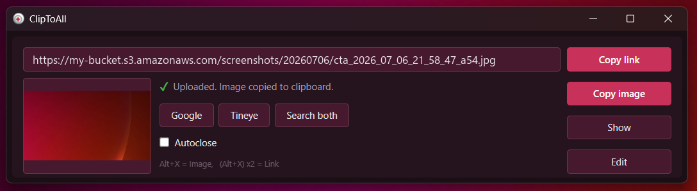
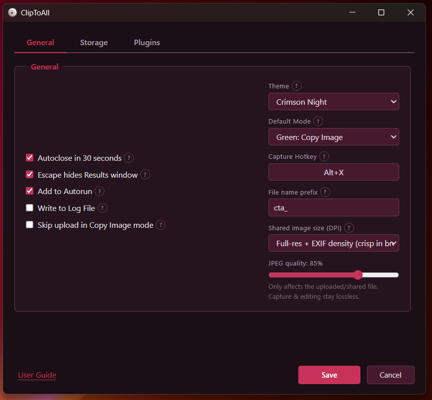
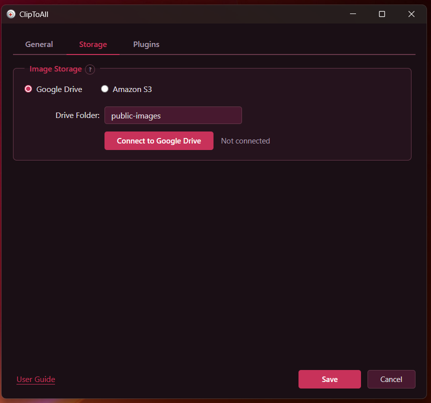
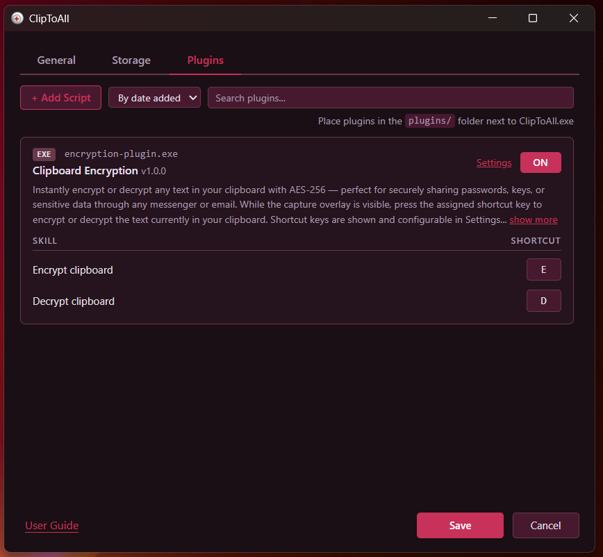
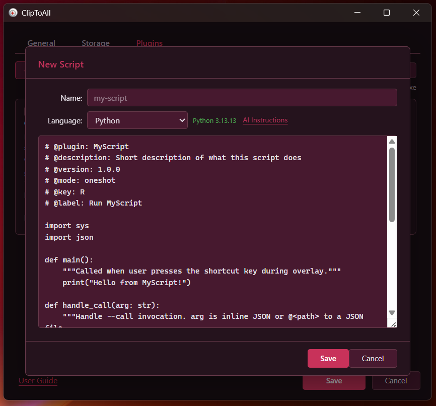
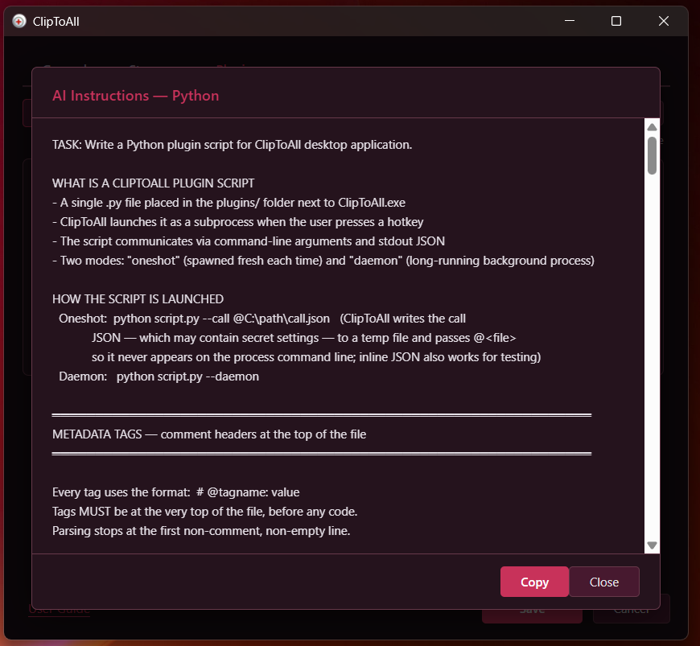

<div align="center">

# ClipToAll

**Screenshot to link in 2 seconds.**

Press a hotkey, select a region, and the link (or the image itself) is on your clipboard — annotated and uploaded, without leaving the keyboard.

[](LICENSE)
[](https://github.com/ultrathinker/cliptoall/actions/workflows/build.yml)
[](https://github.com/ultrathinker/cliptoall/actions/workflows/release.yml)


</div>

<p align="center">
  
</p>

## What it is

ClipToAll is a lightweight desktop screenshot tool. Press **Alt+X**, drag a rectangle over any part of the screen, optionally annotate it, and it is uploaded to your own **Amazon S3** or **Google Drive** with the public link copied to your clipboard. It lives in the tray and stays out of your way.

The app is built on **Tauri 2** (Rust backend + WebView2) with a **Svelte 5** frontend — a ~8 MB executable with no heavy runtime to install.

## Platform support

| Platform | Status |
|----------|--------|
| Windows 10 / 11 | ✅ Supported |
| macOS 14 Sonoma or later (Apple silicon) | ✅ Supported — signed and notarized `.dmg` (see [Download](#download)) |
| Linux (X11 / Wayland) | 🚧 Planned (see [Roadmap](#roadmap)) |

The Windows build uses Win32 APIs; the macOS build uses ScreenCaptureKit for capture, the system pasteboard for the clipboard, the Keychain for secrets, and a webview-based region-select overlay. Linux support is a planned effort — contributions welcome.

macOS limitations in this first release: Apple silicon only (no Intel build), capture covers the primary display only, and the plugin system is Windows-only for now.

## Features

- **Global hotkey capture** — Alt+X (configurable); drag to select any screen region.
- **Two modes** — copy the **image** straight to the clipboard (default), or copy the uploaded **link**; double-tap the hotkey to toggle, or set your preferred default in Settings.
- **Built-in annotation editor** — pencil, rectangles, arrows, and text in 7 colors / 3 sizes, with undo/redo and Ctrl+wheel zoom.
- **Upload targets** — Amazon S3 or Google Drive (OAuth2), link auto-copied.
- **HiDPI-correct output** — choose full-resolution, resized-to-logical, or full-res + EXIF density so shared images look right in browsers.
- **Adjustable JPEG quality** — capture and editing stay lossless; compression is applied only to the shared/uploaded file.
- **Themes** — 5 built-in themes with instant live preview.
- **Clipboard encryption** — optional AES-256 encrypt/decrypt of clipboard text.
- **Plugin system** — extend capture with external tools or scripts (Python / C# / PowerShell / native exe). See [plugins/PLUGIN-PROTOCOL.md](plugins/PLUGIN-PROTOCOL.md).
- **Tray-resident** — autorun, single-instance, minimal footprint.

## Screenshots

| Settings — General | Settings — Storage |
|---|---|
|  |  |

| Plugins | Script editor | AI instructions |
|---|---|---|
|  |  |  |

## Download

Prebuilt binaries for Windows and macOS are published on the **[Releases](https://github.com/ultrathinker/cliptoall/releases)** page.

### macOS

Current version: **[ClipToAll 5.1.26 for macOS](https://github.com/ultrathinker/cliptoall/releases/tag/macos-v5.1.26)**. Download **`ClipToAll-<version>-macos-arm64.dmg`** from that release (or from a newer release tagged `macos-v*`); a `.sha256` file is attached for verification. The app is signed with a Developer ID certificate and notarized by Apple, so Gatekeeper opens it without warnings.

Requirements: **macOS 14 Sonoma or later** on an **Apple silicon** Mac.

1. Open the `.dmg` and drag **ClipToAll** into **Applications**, then launch it.
2. On the first capture macOS asks for **Screen Recording** permission. Enable ClipToAll in **System Settings → Privacy & Security → Screen & System Audio Recording**, then quit and reopen the app if macOS asks you to.
3. The default hotkey is **Ctrl+Cmd+X** (Cmd+X is Cut in every app, so it is not used). Change it in Settings.

Supported destinations are the same as on Windows: your own **Amazon S3** bucket or **Google Drive**. Secrets are stored in the macOS Keychain and settings live in `~/Library/Application Support/ClipToAll`.

### Windows

Each release is produced by [`release.yml`](.github/workflows/release.yml), which is triggered by a `v*` tag and runs `tauri build` on Windows via `tauri-apps/tauri-action`. It attaches two artifacts:

- **`*-setup.exe`** — NSIS installer. Adds a Start Menu shortcut, an uninstall entry, and installs the WebView2 runtime if it's missing.
- **`ClipToAll-<version>-portable.exe`** — standalone single-file executable. No install needed; just run it from anywhere (it self-registers autostart at runtime if you enable it in Settings). Requires the WebView2 runtime, which is preinstalled on Windows 11 and most Windows 10.

> Releases are not code-signed yet, so Windows SmartScreen may warn on first launch — click **More info → Run anyway**.

If you prefer to build from source, see the next section.

## Quick start (build from source)

### Prerequisites

- **[Rust](https://rustup.rs/)** (stable toolchain)
- **[Node.js](https://nodejs.org/)** 18+ and npm
- **Windows:** [WebView2 runtime](https://developer.microsoft.com/microsoft-edge/webview2/) (preinstalled on Windows 11) and the **MSVC build tools** (Visual Studio Build Tools with the "Desktop development with C++" workload)

See the [Tauri v2 prerequisites](https://v2.tauri.app/start/prerequisites/) for details.

### Run in development

```bash
npm install
npm run tauri dev
```

### Build a release binary

```bash
npm run tauri build
```

The executable is produced under `src-tauri/target/release/`, and the installer under `src-tauri/target/release/bundle/`.

## Usage

1. Press **Alt+X** (**Ctrl+Cmd+X** on macOS) and drag to select a screen region.
2. Release — the region is captured and the Results window opens.
3. In the default **Copy Image** mode the screenshot is placed on your clipboard directly. In **Copy Link** mode it is uploaded and the public link is copied instead — double-tap the hotkey to toggle, or set the default in Settings.
4. Click **Edit** to annotate before sharing.

Open **Settings** (from the tray) to configure the storage backend, hotkey, theme, output/DPI mode, JPEG quality, and plugins.

## Configuration

- **Amazon S3** — enter Access Key ID, Secret Access Key, bucket, region, and folder in Settings → Storage. Public access is expected to be provided by your bucket policy (the app uploads without ACLs).
- **Google Drive** — click *Connect to Google Drive* in Settings → Storage and authorize via OAuth2. Uploaded images are shared with a public link. Official release binaries ship with an embedded Google OAuth client, so you only need to log into your own Google account — no setup required.

On Windows, settings are stored as JSON in `%APPDATA%\ClipToAll`, with sensitive fields encrypted at rest via Windows DPAPI. On macOS they are stored in `~/Library/Application Support/ClipToAll` and secrets live in the Keychain. See [SECURITY.md](SECURITY.md) for the security model.

> **Building Google Drive support from source:** the Google OAuth client is *not* committed to this repository. Official release builds inject it at compile time. If you build from source and want Google Drive to work, create your own [Google OAuth 2.0 "Desktop app" client](https://developers.google.com/identity/protocols/oauth2/native-app) and build with the credentials in the environment:
>
> ```bash
> GDRIVE_CLIENT_ID=your-id.apps.googleusercontent.com GDRIVE_CLIENT_SECRET=your-secret npm run tauri build
> ```
>
> Amazon S3 works with no build-time configuration. If neither is built in, uploads to that backend are simply disabled.

## Roadmap

- macOS: Intel / universal build, multi-display capture, plugin system.
- Linux support (X11 first, then Wayland via xdg-desktop-portal).
- Cross-platform overlay unification.

Cross-platform support is a substantial effort concentrated in the platform-specific Rust modules; see the issues tracker if you'd like to help.

## Contributing

Contributions are welcome — see [CONTRIBUTING.md](CONTRIBUTING.md). Please keep code comments in English and never commit secrets.

## Security

For the security model and how to report a vulnerability, see [SECURITY.md](SECURITY.md).

## License

Licensed under the [Apache License 2.0](LICENSE).

## Author

Created by ultrathinker — <https://cliptoall.appshub.net>
